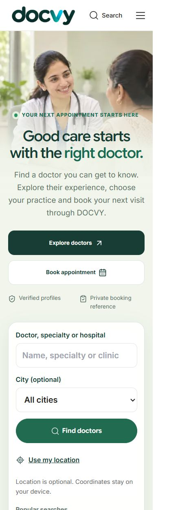

# Mobile layout polish — 17 November 2026

User request: make the mobile view clearer and more organised, reduce the logo slightly, and fix layout/detail mistakes.

- Header logo: 138px on phones, 160px on small tablets, unchanged 180px desktop width. Responsive image sizes match. Mobile footer logo is 150px. Header spacing is tighter while navigation targets retain their size.
- Hero: readable headline/body/trust text and equally aligned booking actions. Existing approved consultation artwork is preserved.
- Search dock: full-width main query field, city and Find doctors together, then optional location action and its explanation. Controls use 16px text and 48px height. Popular searches are readable two-column links.
- Specialties: two columns on phones with complete names; long specialty labels are no longer squeezed into four narrow columns.
- Doctor explorer: vertically arranged mobile filters, 16px control text, clear counts and reset action. Doctor cards retain full-width layouts and align fees/booking actions with larger text and touch targets.
- Related page families: mobile public filters, private-link access, profiles and appointment forms receive consistent control sizes and improved reading order. Underlying authorisation and booking logic are unchanged.

TypeScript, ESLint, production build, discovery and booking-presentation regressions, desktop regression checks and narrow-screen browser verification are required for release. This change uses the existing feature-branch release process; no production database/schema changes or merge to main are included.

## Release verification

Application commit: `7def399315e8adc8b03a945fdb6a66b093b79bd3`.
Production deployment: `dpl_ENG7QmifuwCnqBT6zeLUjfHwmPJb`; Vercel production build READY, assigned to https://www.docvy.in on 17 November 2026. Production environment was built directly; a Preview environment was not promoted.

- TypeScript (`pnpm exec tsc --noEmit`), ESLint, homepage discovery and booking-presentation regression scripts passed.
- Local production build completed; Vercel production build also passed.
- Browser measured actual 320px and 375px viewports. At 320px the homepage, doctor profile and booking page have document width 301px (remaining width is the scrollbar), with no document overflow. The profile previously widened to 542px; its grid now shrinks correctly while the dates scroll within the booking panel.
- At 375px the header logo is 138px, search text is 16px, hero actions align and complete specialty names fit two columns. Search for Anil returns the matching provider. Mobile menu opens/closes correctly.
- At desktop width 1137px the document fits (1118px), the logo remains 180px, and the approved image, hero, navigation and search layout are preserved.
- Live HTTP checks returned 200 for homepage, filtered directory, individual profile, booking, patient access, robots.txt and sitemap.xml. Homepage contains exactly one emergency 112 link. Authenticated booking health returned healthy=true against the production backend.
- No real appointment was submitted during UI testing. No production database data/schema, booking transaction, authorisation or clinic CRM access was changed. Main was not modified and no PR was merged.

