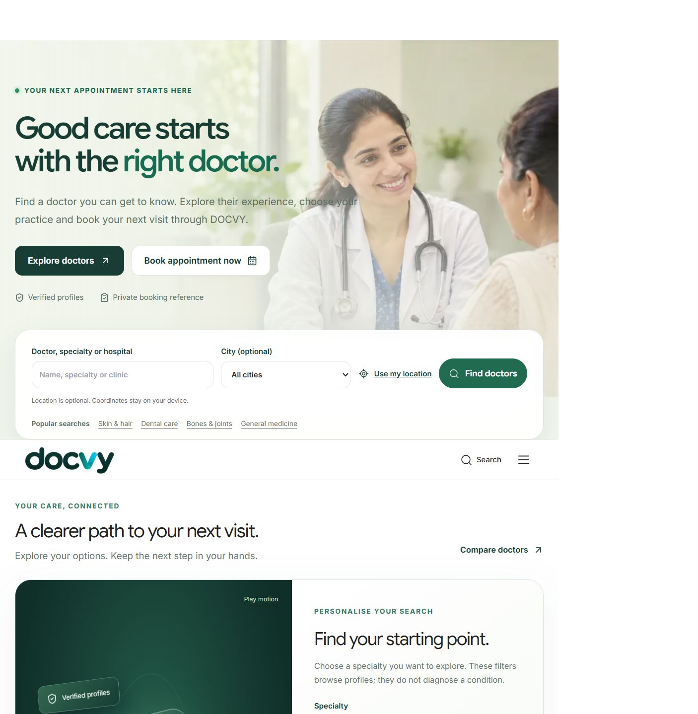
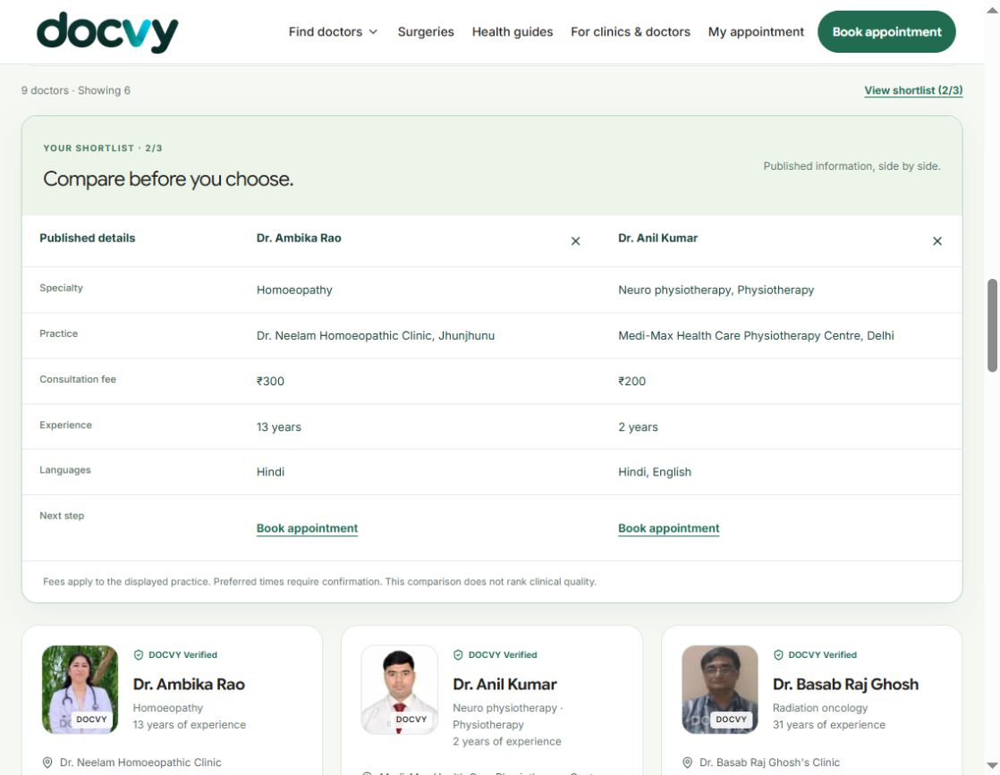
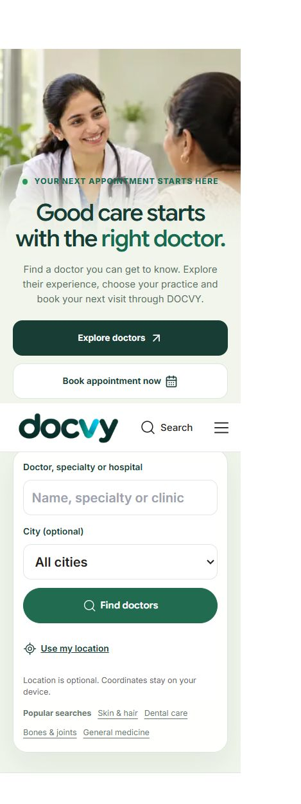

# DOCVY SEO and interactive discovery release — 17 November 2026

## Implemented

- CSS 3D care-journey panel with three interactive stages, floating cards and depth. No Three.js, canvas runtime or new dependencies. Pause/play and reduced-motion support. The approved hero remains unchanged.
- Live-public-data finder: specialty, consultation type and city; real profile counts, practice fees and profile links. An honest empty state replaces fabricated coverage. The full directory link carries specialty/city filters (online uses the Online location).
- In-memory comparison of up to three doctors: published specialty, matching practice/city, location-specific consultation fee, experience, languages and the appropriate booking/profile link. Filter changes clear the shortlist. No preferences or patient information are persisted.
- Specialty guides now display matching published doctors and consistent ItemList data, or state that no matching profiles are published. Existing clinical guidance and its references are preserved.
- Organization description and homepage metadata align with live discovery/appointment coordination. No ratings, clinician reviews, instant slot availability or clinical outcomes are invented.
- Reused the XML/pagination architecture from existing PR #9 and adapted it to the current public directory/route/indexing rules. Removed app/sitemap.ts so it cannot conflict with app/sitemap.xml/route.ts. Unsupported shared 2026-11-14 lastmod values are omitted. Real record modification timestamps are not in the public projection; source-check/verification dates are not substituted for modification times.

## Audit evidence and scope

Before: all 104 URLs from the deployed monolithic sitemap were fetched. Every page returned HTTP 200, matching canonical, title, description and one H1, without noindex. This was a healthy baseline, not a claim of broken SEO everywhere. All sitemap entries shared one hard-coded lastmod; deployed segmented architecture was missing. Specialty guides offered only short preparation copy plus links out to a noindex specialty directory.

After: 103 URLs in six child sitemaps, all fetched again with canonical/indexability/metadata/JSON-LD parsing checks and no failures. The one excluded URL was a nonverified public doctor profile, consistent with the verified-profile sitemap requirement. That public route was not removed. Robots continues to reference https://www.docvy.in/sitemap.xml. Google-selected canonical, indexing and traffic have not been measured.

| Child sitemap | Eligible URLs |
| --- | ---: |
| /sitemaps/static.xml | 15 |
| /sitemaps/directories.xml | 1 |
| /sitemaps/specialties.xml | 25 |
| /sitemaps/surgeries.xml | 40 |
| /sitemaps/content.xml | 13 |
| /sitemaps/doctor-profiles.xml | 9 |

No empty sitemap is emitted. Cities, localities and doctor/specialty/city segments appear only when existing indexability rules are met (at least three matching published profiles and an actual route). None currently qualifies. Hospital and clinic individual profile routes and surgery/city routes do not exist; the hospitals directory remains a static page. There is no invented hospital/clinic/profile coverage. Educational specialty guides remain separate from noindex filtered directory pages.

## Architecture and verification

Source: the existing docvy_public_directory RPC only, with request-scoped memoization. No base-table, CRM, appointment or private data reads were introduced. Static children make no Supabase call. Public dynamic XML has a 300-second CDN lifetime; static XML 3600 seconds, must-revalidate. Publication/removal changes can take up to five minutes to leave cached XML; public profile visibility continues to use the existing uncached publication checks. One canonical owner per URL, stable sorted chunks of at most 10,000 entries, XML escaping, unknown-child 404s, and disabled preview sitemaps.

Passed: TypeScript, ESLint, sitemap/discovery unit checks, existing homepage discovery and booking-presentation regressions. Local production build generated 2455 pages; homepage first-load JS 111 kB (prior release 108 kB). This is build output, not a Core Web Vitals or Lighthouse measurement. Vercel production build passed. XML index and every child validated against the official sitemap XSDs; all 103 page responses, canonical/indexability and robots/unknown-child checks passed.

Browser: journey stage changes, specialty matching, empty combinations, pause/play, three-doctor cap, correct live booking links/fees, clearing comparisons when filters change. The 320px comparison table scrolls within its panel (document 301px), rather than widening the document. A mobile intrinsic-width issue discovered during live review was fixed in the follow-up CSS commit and checked at 375px. Reduced-motion rules remove continuous animation. No real appointment was submitted. Existing booking health is healthy. No production data/schema, auth, clinic access, main or PR merge changes.

## Search Console submission and monitoring

Search Console and analytics are not connected through the available tools. Eligible URL counts above are not submitted or indexed counts. Do not fill unknown metrics with zero or example data.

1. In the verified DOCVY property, submit https://www.docvy.in/sitemap.xml. The same root now discovers six children. Verify each child succeeds; optionally submit the six children separately for clearer reporting.
2. Inspect the homepage and representative changed specialty guides (for example /specialties/general-medicine, /specialties/paediatrics and /specialties/urology). Compare declared versus Google-selected canonical and live crawl, then request indexing for changed priority pages. Let the sitemap handle the remaining changed specialty pages; do not bulk-request unchanged pages.
3. Inspect one verified profile from /sitemaps/doctor-profiles.xml and one guide from /sitemaps/content.xml. Confirm robots and indexing eligibility, without forcing intentionally noindex city/filter pages into the index.
4. Record a real 28-day baseline, then review weekly using matching periods: submitted/eligible URLs, indexed URLs, indexed/submitted percentage, crawled-not-indexed, discovered-not-indexed, duplicate/canonical exclusions and sitemap errors, broken down by sitemap. Use URL Inspection for specific exclusions.
5. Export organic clicks, impressions, CTR and average position by page group, device and country. Compare equivalent prior periods and annotate this release. Rankings or indexing are not guaranteed by sitemap submission.
6. Organic patient bookings require first-party attribution with consent, a documented source definition and deduplicated booking IDs. Do not infer visits or confirmed bookings from a request button click. No patient names, contact details or medical concerns should enter public analytics.

## Next product work, in priority order

1. Verified post-visit feedback: accept feedback via an appointment-linked patient flow, with consent, moderation and one review per eligible visit. Publish ratings only once real approved reviews exist. Success measure: eligible completed visits versus approved patient feedback, not invented stars.
2. Provider-maintained availability: extend the existing booking system only when each practice has operational schedules. Handle simultaneous attempts and confirmation truthfully; do not label preferred-time suggestions as live slot inventory.
3. Hindi discovery parity: translate the working finder, profiles and booking guidance with consistent canonicals/hreflang. Measure Hindi discovery-to-request conversion after analytics is connected.
4. Search-to-visit measurement: consent-aware first-party conversion events and founder reporting for request, confirmed, cancelled and patient-verified visit outcomes. Reuse existing booking records; no competing CRM or new clinic login requirement.
5. Content improvement based on real query data: expand the specialty/guide pages attracting relevant impressions with clinician-reviewed, source-backed answers. Do not mass-generate city or medical doorway pages. Build currently enumerates many thin city/specialty routes; limiting prerendered routes to meaningful coverage is a performance follow-up, while their existing noindex rules remain intact.

## Sources and measurement limits

- [Google: building and submitting sitemaps](https://developers.google.com/search/docs/crawling-indexing/sitemaps/build-sitemap), retrieved 17 November 2026: accurate lastmod and submission guidance; a sitemap is a hint rather than an indexing guarantee.
- [Next.js 14.2.35 Metadata API](https://github.com/vercel/next.js/blob/v14.2.35/docs/02-app/02-api-reference/04-functions/generate-metadata.mdx), retrieved through Context7: canonical/social metadata and server/client composition.
- [DocIndia public homepage](https://www.docindia.org/), retrieved 17 November 2026: public navigation advertises specialty/location search, telehealth, profile comparisons, reviews and health questions. These are observed marketing/UI claims, not independently verified operational capabilities. Scraped counters were inconsistent/zero, so none is used as market evidence. The product opportunities above focus on useful, verifiable DOCVY capabilities.
- [Live DOCVY](https://www.docvy.in/), raw head/source and automated crawl on this date. Baseline and released checks are recorded in seo-baseline-20261117.json and seo-release-20261117.json. No backlink, keyword-volume, Search Console, Lighthouse or field-performance access is claimed.

## Release

App commit: 71d22b3787263b144b05af9d8d802f900a3ac32e (mobile width correction after 05f112f). PR: https://github.com/rishimartin816-ui/Docvy/pull/19. The final production deployment and visual evidence are recorded below after the mobile verification completes.

Final production deployment: `dpl_9PEcuhgwsZZjaxMvjQ3EmNZF9QVA`, READY and assigned to https://www.docvy.in. The final mobile scene measures 282px inside a 375px viewport (document 356px); floating-card labels are readable. Live comparison booking URLs retain the selected provider, city and facility. The original 103-URL audit/XSD checks were performed against the same release before its CSS-only mobile sizing follow-up; sitemap/server logic is unchanged.

