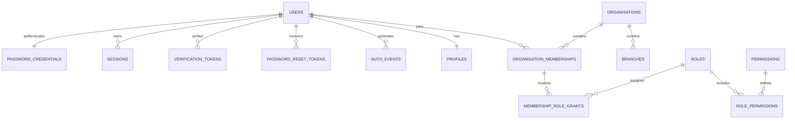

# DOCVY Custom Authentication and Tenant Security

**Version:** 1.0  
**Date:** 2026-11-01  
**Status:** Approved design baseline; implementation in progress  
**Target:** Next.js 14, PostgreSQL 17, local development and pre-production staging
**Production gate:** Separate hosting, privacy, security and deployment approval

## 1. Decisions

- DOCVY will own its authentication implementation. Supabase Auth is not part of this design.
- PostgreSQL stores login identities, Argon2id password hashes, opaque sessions, verification tokens and password-reset tokens.
- Only SHA-256 token hashes are stored in the database.
- One human identity can belong to multiple organisations.
- Staff authorization is membership + role grant + permission + organisation/branch scope.
- PostgreSQL RLS is the final tenant boundary. Server-side authorization is an additional control.
- The initial staff-role catalogue contains exactly eight roles.
- Patient identity and patient self-service access are separate from the eight staff roles.
- No clinical-record permission is enabled by this foundation migration.
- The existing medical-documentation routes remain isolated and are not part of the healthcare-platform homepage.

## 2. Entity model

### Identity tables in migration 0002

| Table | Purpose |
|---|---|
| `identity.users` | Normalized email, account status and verification timestamp |
| `identity.password_credentials` | Argon2id password hash |
| `identity.sessions` | Opaque session-token hash, expiry and revocation |
| `identity.verification_tokens` | Single-use email-verification token hashes |
| `identity.password_reset_tokens` | Single-use recovery-token hashes |
| `identity.auth_events` | Minimal authentication/security event history |

Identity tables are in a non-exposed schema. Runtime roles receive no direct table grants. Approved authentication functions will be the access path.

The existing `public.profiles` table is linked one-to-one in a later migration. This is deliberately separated so existing profile rows can be assessed and safely backfilled before a foreign key is validated.

## 3. Eight staff roles

| Role | Intended scope | Core boundary |
|---|---|---|
| Organisation owner | Organisation | Organisation administration and ownership transfer through a dedicated audited operation |
| Organisation admin | Organisation | Staff, branches and operational configuration; cannot transfer ownership |
| Clinic manager | Organisation or assigned branch | Day-to-day clinic/branch operations |
| Doctor | Organisation or assigned branch | Provider profile, own schedule and clinically authorised workflows |
| Nurse | Assigned branch | Assigned nursing workflows; clinical access requires separate approval |
| Receptionist | Assigned branch | Patient registration, non-clinical demographics and appointment queue |
| Billing operator | Organisation or assigned branch | Financial workflows; no clinical-note access |
| Auditor | Organisation | Read-only access to explicitly permitted operational and audit records |

Role names are not authorization checks. Permission keys are the contract. Initial namespaces include:

- `organisation.read`, `organisation.update`
- `branch.read`, `branch.create`, `branch.update`
- `membership.read`, `membership.invite`, `membership.suspend`
- `role_grant.read`, `role_grant.manage`
- `provider_profile.read`, `provider_profile.update`, `provider_profile.publish`
- `schedule.read`, `schedule.manage`
- `appointment.read`, `appointment.create`, `appointment.manage`
- `patient.demographics.read`, `patient.demographics.update`
- `billing.read`, `billing.manage`
- `audit.read`

Clinical permissions are withheld until professional verification, clinical safety and clinical-domain access rules have been separately reviewed. Ownership and general administration do not automatically confer clinical access.

## 4. Authentication contract

### Registration

1. Normalize and validate email.
2. Apply a documented password policy.
3. Hash with Argon2id.
4. Insert user and password credential in one transaction.
5. Create the linked profile through the controlled onboarding path.
6. Issue a single-use verification token.
7. Do not grant organisation owner or staff roles by default.

### Session creation

1. Generate a cryptographically random 256-bit opaque token.
2. Store only SHA-256(token) in `identity.sessions.token_hash`.
3. Set an HttpOnly, Secure, SameSite=Lax cookie.
4. Apply expiry and rotation policy.
5. Revoke the server-side session on logout, password reset or account suspension.

### Database identity context

- The server validates the cookie and computes the session-token hash.
- Every authenticated tenant transaction sets a transaction-local `docvy.session_token_hash` setting using `set_config(..., true)`.
- A narrowly scoped SECURITY DEFINER helper resolves the user only by matching that hash to a non-revoked, non-expired session and an active account.
- RLS never trusts a browser-supplied user ID, organisation ID, branch ID or role.
- The helper has a fixed safe search_path, fully qualified object references, a non-login owner, revoked PUBLIC execution and explicit EXECUTE grants.
- The app must keep context setup and tenant queries in the same transaction. Connection reuse must not retain identity context.
- The session-token hash is a bearer capability inside the database connection. Never log it, expose it to the browser or allow it into error telemetry.

This model deliberately does not trust an unsigned user-ID custom setting. A setting is only a carrier for a server-derived session capability, and the database verifies it against current session state.

## 5. Database privilege model

| Role | Login | Responsibility |
|---|---:|---|
| `docvy_admin` | Existing bootstrap only | Local database administration; never application traffic |
| `docvy_migrator` | No | Controlled schema migrations |
| `docvy_app` | No | Existing tenant-table privilege group, constrained by RLS |
| `docvy_auth_fn` | No | Owns identity tables and narrowly scoped SECURITY DEFINER functions |
| `docvy_auth_runtime` | No | Group role for EXECUTE on approved authentication functions only |

Separate login principals must be provisioned out-of-band for runtime connections. This migration does not create login passwords or store secrets.

All runtime roles must be NOSUPERUSER, NOCREATEDB, NOCREATEROLE and NOBYPASSRLS. Runtime roles must not own tenant tables. The bootstrap administrator is never used by the application.

## 6. Tenant authorization

A protected operation requires all of:

1. Valid, active session.
2. Active account.
3. Active membership in the requested organisation.
4. Applicable role grant.
5. Permission key.
6. Matching organisation and branch scope.

RLS policy predicates must use database-verified identity and current membership/grant state. UPDATE policies need both USING and WITH CHECK. Composite foreign keys remain mandatory to prevent cross-organisation branch references.

RLS is enabled on every exposed tenant table. Consider FORCE ROW LEVEL SECURITY after verifying migration-owner workflows. Superusers and BYPASSRLS roles remain outside the application runtime boundary.

Public provider discovery is a separate, explicitly allow-listed read model. It must not serialize private membership, verification evidence, patient or clinical fields.

## 7. Migration sequence

| Migration | Scope | Execution status |
|---|---|---|
| 0001 | Organisation, branch, membership, role and audit foundation | Applied to local `docvy_dev` and empty Mumbai Free pre-production project |
| 0002 | Identity schema, private roles and secure default function ACLs | Applied to disposable PostgreSQL 17 test DB and Mumbai pre-production project; Supabase role grant added in commit `306fb2d` |
| 0003 | Enable RLS on six private identity tables; no policies | Applied to Mumbai pre-production project; not applied to local `docvy_dev` |
| 0004 | Profile/identity link and safe backfill | Not prepared |
| 0005 | Registration, credential, token and session functions | Not prepared |
| 0006 | Runtime login-role grants and function execution grants | Not prepared |
| 0007 | Transaction-scoped session identity helper | Not prepared |
| 0008 | Eight-role permission catalogue and reviewed grants | Not prepared |
| 0009 | Tenant RLS policies | Not prepared |
| 0010 | Audit append-only functions and restrictions | Not prepared |

The Mumbai project is on Supabase Free and is pre-production only: it has no application traffic or data. All 17 application tables currently have RLS enabled with no policies, so they fail closed. The `identity` and `docvy_private` schemas have no API-role schema usage. The Free plan has no automatic daily backups and can pause for inactivity; do not put production, patient or staff data there.

Every migration must be reviewed and verified against a disposable PostgreSQL 17 database. Production execution requires separate explicit approval, paid backup/restore coverage, and a reviewed access policy.

## 8. Security test gates

- Duplicate case-insensitive email is rejected.
- Invalid password does not issue a session.
- Expired, revoked and suspended sessions fail.
- Reset token is single-use and revokes existing sessions.
- Non-member cannot read or mutate an organisation.
- Tenant A cannot read, insert, update or delete tenant B rows.
- Branch-scoped role cannot access another branch.
- Receptionist and billing roles cannot access clinical notes.
- User cannot self-grant owner/admin permissions.
- Tenant/branch reassignment is rejected by RLS and composite constraints.
- Forged user-ID and tenant-ID settings grant no access.
- Runtime roles cannot read identity tables directly or modify permission catalogues.
- Audit records cannot be updated or deleted through runtime paths.
- Public provider results contain only allow-listed public fields.

## 9. Release boundary

The public website release is independent of this authentication foundation. No login, provider search, booking, clinic dashboard, hospital management or clinical-record capability should be advertised as live until the corresponding workflows are implemented and tested.

No patient or clinical data is permitted in the local development database. India-region production hosting, backup/restore, privacy operations, legal review and healthcare-specific security controls remain separate release gates.
