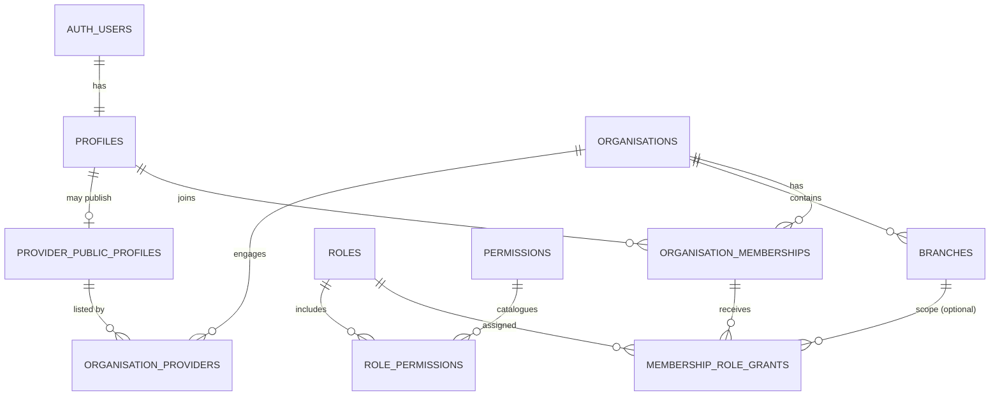

# DOCVY Tenant Identity, Organisation and Authorization Design

**Status:** Proposed design for review — not an applied database schema  
**Date:** 2026-11-01  
**Related issue:** DOC-7  
**Environment gate:** DOC-6 must be resolved before any production migration or patient/clinical data is admitted.

## 1. Design objectives

1. One human identity may belong to multiple practices, clinics or hospitals.
2. An organisation may have multiple branches.
3. A staff member's access is granted through an organisation membership and explicit role grants.
4. Role grants can be organisation-wide or branch-scoped.
5. Patient identity is not the same thing as staff membership.
6. Public provider discovery fields are separated from private operational and clinical records.
7. PostgreSQL Row Level Security (RLS) is the final tenant boundary; application checks are an additional layer, not a substitute.
8. The existing medical-documentation request workflow remains isolated and unchanged.

## 2. Proposed entity relationship model

### Core tables

| Table | Purpose | Tenant key / ownership |
|---|---|---|
| `profiles` | Minimal platform identity/profile linked 1:1 to `auth.users` | User-owned; not a tenant table |
| `organisations` | Doctor practice, clinic or hospital account | `id` |
| `branches` | Physical/operational locations | `organisation_id` |
| `organisation_memberships` | User's active/invited relationship with an organisation | `organisation_id` |
| `roles` | Controlled role catalogue and scope type | Platform catalogue |
| `permissions` | Stable permission keys and descriptions | Platform catalogue |
| `role_permissions` | Role-to-permission mapping | Platform catalogue |
| `membership_role_grants` | Role assignment at organisation or branch scope | `organisation_id`, optional `branch_id` |
| `provider_public_profiles` | Moderated, publishable professional directory fields | Provider profile |
| `organisation_providers` | Relationship between a provider and an organisation | `organisation_id` |
| `audit_events` | Append-only security and administrative event trail | `organisation_id` where applicable |

### Important relational constraints

- Use UUID primary keys for application entities.
- `profiles.id` references `auth.users.id`; create the profile through a controlled server-side onboarding path.
- `branches` has a unique composite key on (`organisation_id`, `id`) so a grant cannot reference a branch from another organisation.
- `organisation_memberships` has a unique constraint on (`organisation_id`, `user_id`).
- `membership_role_grants` references a membership and optional branch using composite foreign keys that include `organisation_id`.
- A branch-scoped role grant must reference a branch belonging to the same organisation as the membership.
- Organisation type is constrained to `doctor_practice`, `clinic`, or `hospital`; do not infer type from a user-supplied display name.
- Membership status is constrained to `invited`, `active`, `suspended`, or `removed`.
- Use explicit `created_at`, `updated_at`, and actor references where relevant. Avoid hard deletes for memberships and security events.
- Do not store role names in `auth.users.user_metadata` or trust user-editable JWT metadata for authorization.

## 3. Role and permission model

Use permission keys as the authorization contract; role names are curated bundles of permissions. This prevents application code from scattering role-name checks and allows narrowly scoped custom roles later.

### Initial role catalogue

| Role | Typical scope | Initial permission bundle |
|---|---|---|
| Organisation owner | Organisation | All organisation administration; invite/revoke members; manage branches, billing settings and role grants |
| Organisation admin | Organisation | Manage staff, branches, services and operations; cannot transfer ownership |
| Clinic manager | Organisation or branch | Manage branch operations, schedules, staff workflows and reports |
| Doctor | Organisation or branch | Manage own provider schedule and authorised patient encounters; clinical permissions remain separately gated |
| Nurse | Branch | Assigned care workflows and explicitly authorised clinical tasks |
| Receptionist | Branch | Patient registration, appointment queue and non-clinical demographics; no clinical note access by default |
| Billing operator | Organisation or branch | Invoices, payments and financial reports; no clinical note access |
| Auditor | Organisation | Read-only access to permitted audit and operational records |
| Patient | No staff membership by default | Patient-owned self-service data through a separate patient relationship model |
| Platform support/admin | Platform scope | Separate privileged platform workflow with explicit reason, time-bound elevation and audit |

### Permission namespaces

- `organisation.read`, `organisation.update`, `organisation.delete`
- `branch.read`, `branch.create`, `branch.update`, `branch.archive`
- `membership.read`, `membership.invite`, `membership.suspend`, `membership.remove`
- `role_grant.read`, `role_grant.manage`
- `provider_profile.read`, `provider_profile.update`, `provider_profile.publish`
- `schedule.read`, `schedule.manage`
- `appointment.read`, `appointment.create`, `appointment.manage`
- `patient.demographics.read`, `patient.demographics.update`
- `clinical_record.read`, `clinical_record.create`, `clinical_record.amend`, `clinical_record.sign`
- `billing.read`, `billing.manage`
- `audit.read`

Clinical permissions are not automatically inherited from generic clinic administration. The clinical permission catalogue and professional verification requirements need a separate clinical-safety review before implementation.

## 4. Authorization semantics

1. Authenticate the request and resolve the user from the validated Supabase session.
2. Resolve an active organisation membership for the requested organisation.
3. Resolve the permission from role grants that apply to the requested organisation and branch.
4. Deny by default if identity, membership, scope or permission is missing.
5. Enforce the same boundary in PostgreSQL RLS for every exposed tenant-owned table.
6. For branch-scoped data, require both organisation membership and a matching branch-scoped permission.
7. Do not accept `organisation_id`, `branch_id`, role or permission claims as authoritative merely because the browser supplied them.
8. Log privileged actions, membership/role changes, access to sensitive records and support elevation.

### RLS implementation direction

- Enable RLS on every application table in an exposed schema.
- Policies target `authenticated` explicitly and use `(select auth.uid())` for the caller identity.
- Tenant-owned rows are filtered through active membership and the relevant permission.
- UPDATE policies require both `USING` and `WITH CHECK` so a caller cannot move a row into another tenant.
- Use composite foreign keys and constraints to prevent cross-tenant references even if an application bug submits mismatched IDs.
- Keep authorization helper functions in a non-exposed schema such as `private`; fully qualify referenced objects and set a fixed empty search path.
- If a helper must use `SECURITY DEFINER` to avoid recursive membership-policy evaluation, keep it minimal, check `auth.uid()` internally, revoke default PUBLIC execution, grant only the required role, and review it as privileged code. Do not add SECURITY DEFINER as a generic workaround.
- Views over tenant data must use `security_invoker = true` where supported, or remain in a non-exposed schema with explicit grants.
- Never expose a service-role key to browser code. Service-role access bypasses RLS and must remain tightly controlled server-side.

## 5. Public and private data boundaries

**Public discovery schema/data:** approved display name, specialty, professional credentials that have been verified for publication, public biography, organisation/branch public address and published services.

**Private organisation data:** staff membership, internal schedules, operational tasks, financial records, unpublished verification evidence and internal notes.

**Patient/clinical data:** patient identity and contact data, consent, encounters, clinical notes, vitals, diagnoses, prescriptions and attachments. This is a separate restricted domain and must not be exposed through public provider views, general search, or analytics.

A public provider profile must not join or serialize private membership, patient, clinical, or verification evidence fields.

## 6. Onboarding and lifecycle

- User signs up through Supabase Auth; profile creation is controlled and idempotent.
- Organisation creation creates the first owner membership atomically.
- Additional users enter through invitation records with single-use, expiring tokens stored hashed; invitation acceptance is tied to the authenticated email/account.
- Membership suspension/removal revokes future access immediately at the database authorization layer. Existing JWT claims must not be treated as the source of current membership or role truth.
- Ownership transfer requires explicit confirmation, an audit event and a transaction that ensures at least one active owner remains.
- Branch transfers are not supported as a simple update; create a new branch relationship and migrate dependent records through a reviewed workflow.

## 7. Indexing and performance

Initial indexes to include in the eventual migration:

- `organisation_memberships(user_id, status)`
- `organisation_memberships(organisation_id, status)`
- `branches(organisation_id, status)`
- `membership_role_grants(organisation_id, membership_id, branch_id)`
- `role_permissions(role_id, permission_id)`
- `organisation_providers(organisation_id, provider_profile_id, status)`

Add indexes only after query plans and realistic access patterns are reviewed. RLS predicate columns must be indexed.

## 8. Migration and rollback plan

**Do not apply this design to the connected project yet.**

1. Resolve DOC-6: classify the connected US East project as development/test or production; approve the India data-residency, backup/restore and migration posture.
2. Confirm the target project and region. If a new India-region project is required, provision and validate it before any patient/clinical data exists.
3. Create a versioned migration using the Supabase CLI migration workflow; do not hand-edit the remote schema.
4. Apply to a disposable development database first.
5. Seed only non-sensitive role/permission catalogue rows.
6. Run RLS tests as anonymous, authenticated non-member, member of tenant A, member of tenant B, branch-scoped staff and platform support.
7. Verify positive access and cross-tenant denial for SELECT, INSERT, UPDATE and DELETE.
8. Review Supabase security/performance advisors and inspect grants, function execution privileges, views and exposed schemas.
9. Back up and rehearse restore before production rollout.
10. Production migration requires explicit approval after the environment decision.

Rollback: the first migration should be additive and contain no destructive alterations to legacy tables. Rollback is a reviewed down-migration that removes only the new platform tables, functions, policies and grants in dependency order. If any tenant data has been written, prefer forward-fix or restore from a verified backup rather than dropping data.

## 9. Required automated tests

- User A cannot read, insert, update or delete tenant B rows.
- A member of organisation A cannot reference a branch from organisation B.
- A receptionist cannot read clinical notes or prescriptions.
- A billing operator cannot access clinical records.
- A doctor without an active membership cannot access former organisation records.
- A branch-scoped manager cannot manage a different branch unless separately granted.
- A suspended or removed member loses access even if the browser still has an unexpired JWT.
- A user cannot self-assign owner/admin roles or modify role catalogue/permission mappings.
- An UPDATE that changes `organisation_id` or `branch_id` is rejected.
- Public provider discovery responses contain no private operational or patient/clinical fields.
- Audit events are written for membership, role, ownership and sensitive-access changes.

## 10. Decisions still required

- DOC-6: Is the connected US East Supabase project a development/test environment or intended production?
- DOC-6: Is India-region data residency required by the product's legal, contractual or customer commitments?
- DOC-7: Approve the initial role catalogue and whether custom roles are needed for the first release.
- DOC-7: Confirm whether doctors can belong to multiple organisations and whether provider profiles are globally reusable across them. This design assumes yes.
- DOC-7: Confirm whether platform support access is permitted, and if so require time-bound elevation and reason capture.

## 11. Current implementation status

- Design document: proposed.
- Database migrations: not created or applied.
- Supabase public application tables: none observed during the 2026-11-01 inspection.
- Authentication UI/session implementation: not started.
- RLS policy tests: not started.
- Production data: must not be added until the environment/residency gate and security acceptance criteria are met.
